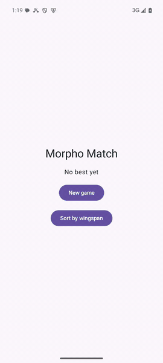
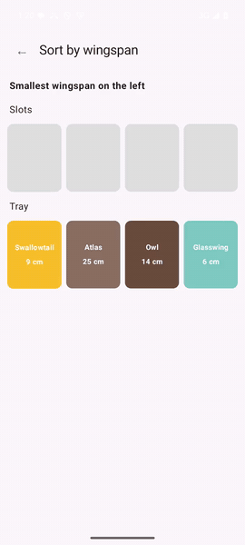
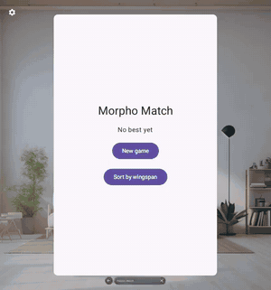
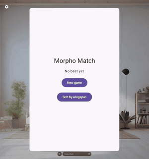
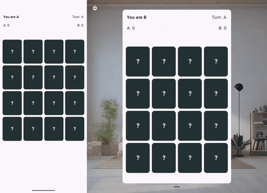
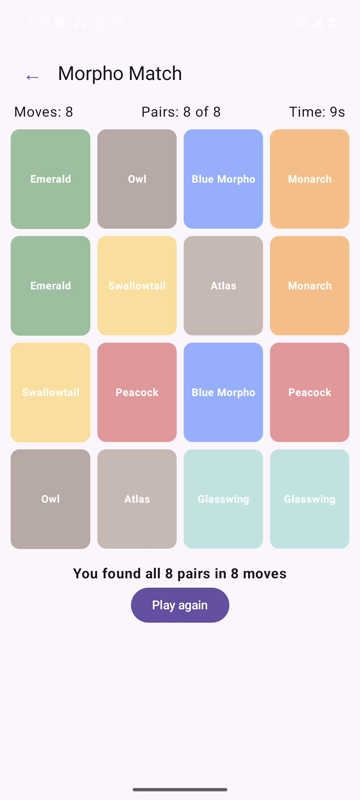
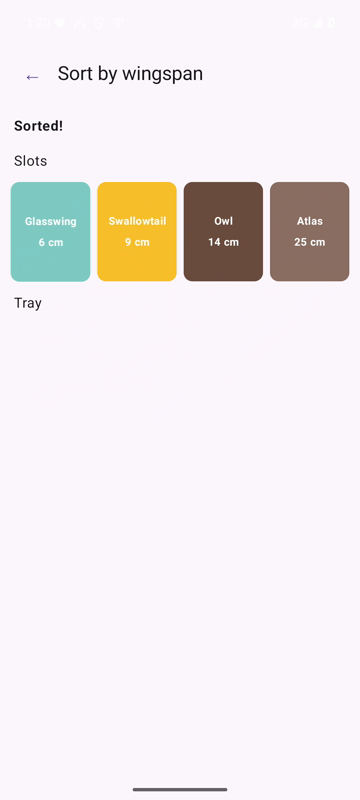
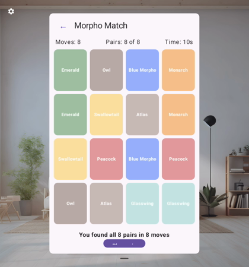
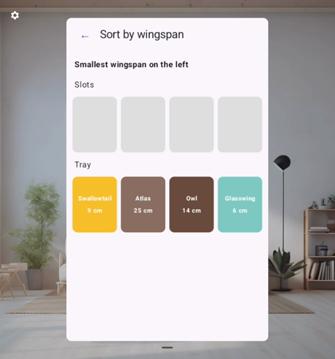

# Morpho Match

A memory game built as an *app under test* for
[Mobium](https://github.com/mobiumdev/mobium): flip cards to find eight pairs
of butterflies, then sort four of them by wingspan by dragging them into
slots, alone or as two players on two devices. **Jetpack Compose** on
Android, running unchanged on phones and on **Meta Quest**'s 2D panels
(Horizon OS), with a switch of **deliberate bugs** a test suite can be scored
against, and a small Go server for the two-player game.

Nothing leaves the device but the two-player game's moves, which go to a
server on the same machine. A seed in the link fixes the deal, so a run is
deterministic.

A sibling of [Morpho Market](https://github.com/mobiumdev/morpho-market),
the store app under test: Morpho Market tests forms, money and a checkout;
Morpho Match tests what a game needs, which is state that changes by itself,
drags, and two devices that must agree.

## See it run

Mobium tests from `tests/match.test.json`, recorded as they ran. Shown at
double speed.

**On a phone** (Android 15 emulator): a whole game in eight moves, every
pair found, and the sort level solved by four drags.

| Every pair in eight moves | Sorted smallest to largest by dragging |
|---|---|
|  |  |
| [Full run, MP4](docs/media/phone-game.mp4) | [Full run, MP4](docs/media/phone-sort.mp4) |

**On a Meta Quest** (Meta Spatial Simulator, Horizon OS): the same app, as a
panel in a room. The game passes. The sort level **fails on purpose**: on a
Quest panel, drawn 2.48 times its size, a Compose drag carries a card about
2.4 times as far as the finger, past every slot and back to the tray. The
level drops a card where its drag carried it, to catch exactly that (Mobium's
CHALLENGES 367 and 368).

| Every pair in eight moves | The sort level, failing |
|---|---|
|  |  |
| [Full run, MP4](docs/media/quest-game.mp4) | [Full run, MP4](docs/media/quest-sort.mp4) |

**Two players on two devices**: player A on the phone, player B on the
Quest, one game held by the server, played to the end. The script reads
both screens after every move: B's flip on A's turn refused, A's Monarchs
kept and A plays again, a mismatch turned back on both and the turn handed
over, B's four pairs, B's mismatch handing the turn back, then A's last
three, and a draw at 4 each on both. Shown at normal speed; a mismatch
stays up for 3 seconds, as the tests ask.



[Full run, MP4](docs/media/duo.mp4)

Where each run ended:

| Phone: the game | Phone: sorted | Quest: the game | Quest: the sort, failed |
|---|---|---|---|
|  |  |  |  |

Recorded on an Android 15 emulator and the Meta Spatial Simulator
207.0.0.83.331, with Mobium at `c5f0c6f` (the two-player game at
`57195af`), by the device's own screen recorder.

## Contents

- [See it run](#see-it-run)
- [Why it exists](#why-it-exists)
- [What is in it](#what-is-in-it)
- [Install a release](#install-a-release)
- [Build and install](#build-and-install)
- [Run the tests](#run-the-tests)
- [Two players](#two-players)
- [The bug switch](#the-bug-switch)
- [Results](#results)
- [Not yet](#not-yet)
- [License](#license)

## Why it exists

A store's checkout tests forms and arithmetic. A game tests what a store
never does:

- **The screen changes by itself.** A mismatched pair turns back after
  800 ms, so a test must wait for a state, not sleep for a time.
- **Drags carry the state.** The sort level is played only by dragging, and
  a card lands where the drag carried it, not where the finger let go. A
  device that magnifies drags, as a Quest panel did, puts it in the wrong
  slot, and the test says so.
- **Two devices must agree.** In the two-player game, one move on one
  device must show on the other, and a move out of turn must be refused on
  both.
- **The deal must be known.** A shuffled board makes every test flaky by
  design, so the deal comes from a seed in the link.

## What is in it

Each mechanic is there to test something:

| Mechanic | What it tests |
| --- | --- |
| 16 cards, 8 species, turned over two at a time | taps, and state read from content descriptions (`Card 3, Blue Morpho`, `Card 5, Monarch, matched`) |
| A mismatch turned back after 800 ms | waits on a screen that changes by itself |
| Moves, pairs and a timer; the best score kept | state that outlives a game |
| A seed in the link (`morphomatch://play?seed=42`) | a deal a test knows; `GameTest` pins seed 42's |
| The sort level: four butterflies dragged into slots by wingspan | drags. A card drops where its *offset* carried it (the drag's summed steps) |
| A chime on a match | sound, for `mobium audio` (not yet in a test) |
| Two players, a server, turns | two devices that must agree, and a move out of turn |
| A switch of bugs (`morphomatch://bugs?on=…&off=all`) | the suite catches each one |

The butterflies are the Blue Morpho, Monarch, Swallowtail, Glasswing, Owl,
Peacock, Atlas and Emerald, each with its color and wingspan.

```
android/   the app: Compose, one module (Game.kt: the rules; MainActivity.kt: the screens; Duo.kt: the two-player screen)
server/    the two-player server, in Go
tests/     match.test.json, the configs, matrix.sh
tests-duo/ duo-play.sh, duo-matrix.sh and duo-outage.sh, the two-device scripts
docs/media the recordings above
```

## Install a release

Each tag `v*` publishes the game, `MorphoMatch-android.apk` (a phone or a
Meta Quest), and the two-player server for Linux, macOS and Windows,
`morpho-match-server-<os>-<arch>`, with `SHA256SUMS`, made by
`.github/workflows/release.yml` under names that stay the same from release
to release.

```sh
gh release download -R mobiumdev/morpho-match -p MorphoMatch-android.apk
adb install -r MorphoMatch-android.apk

gh release download -R mobiumdev/morpho-match -p morpho-match-server-darwin-arm64
chmod +x morpho-match-server-darwin-arm64 && ./morpho-match-server-darwin-arm64 -seed 42
```

The APK is signed with the build machine's debug key, so uninstall one you
built yourself before installing a release over it.

## Build and install

Needs JDK 21 and the Android SDK; the server needs Go.

```sh
cd android
ANDROID_HOME=<your Android SDK> ./gradlew :app:testDebugUnitTest :app:assembleRelease
mobium install app/build/outputs/apk/release/app-release.apk
```

The unit tests (`GameTest`, 7 tests) pin seed 42's deal and the rules. The
app opens on its home screen; the links open a game, the sort level, the
two-player game, or switch bugs:

| Link | Opens |
| --- | --- |
| `morphomatch://play?seed=42` | a game with seed 42's deal |
| `morphomatch://sort?seed=42` | the sort level |
| `morphomatch://duo?player=A&server=http://10.0.2.2:8787` | the two-player game as A (an emulator reaches the Mac at `10.0.2.2`) |
| `morphomatch://bugs?on=score-double&off=all` | turns bugs on and off |
| `morphomatch://reset` | clears the best score and goes home |

## Run the tests

Seven tests in `tests/match.test.json`, the same file on every device:

```sh
mobium test --config tests/mobium.config.json                                   # emulator-5554
MOBIUM_QUEST_DEVICE=emulator-5556 mobium test --config tests/quest.config.json  # the Quest simulator
```

Each test opens its own deal and starts over, so they can run in any order.
On a Quest the app runs as a panel; Mobium's
[HORIZON-OS.md](https://github.com/mobiumdev/mobium/blob/main/docs/HORIZON-OS.md)
says how to set up the Meta Spatial Simulator and what is driven there.

## Two players

`server/` holds the one game: turns, a match keeps the turn, a mismatch is
turned back and hands it over. Each device polls it and shows the board,
both scores and whose turn it is. It listens on `127.0.0.1:8787`.

```sh
cd server && go test ./... && go run . &              # seed 42, pinned in duo_test.go
tests-duo/duo-play.sh emulator-5554 emulator-5556     # a game to a draw, both screens read at every move
tests-duo/duo-matrix.sh emulator-5554 emulator-5556   # each server bug alone, caught where it should be
tests-duo/duo-outage.sh emulator-5554 emulator-5556   # the server stopped mid-game and started again
```

`duo-play.sh` plays seed 42 to the end, a draw at 4 each, and resets the
game with a mismatch held up for 3 seconds (the game's own is 0.8): read
one after the other, the Quest missed a pair that was up for 0.8 seconds,
three runs in three. `duo-matrix.sh` fails unless the game passes with no
bug on, and each bug fails it at the step that should catch it.
`duo-outage.sh` runs its own server on port 8788, so it can stop it: both
devices must say the server did not answer, keep the last board, refuse a
flip as unanswered, and, once it is back, drop the message and show its new
game — the game lives in the server's memory, so a restart is a new one.

A `mobium test` file cannot do this, because its steps run in batches on its
project's device and a step naming another device is refused. So the
two-device tests are scripts that drive both devices through one Mobium
daemon, which holds a session per device.

## The bug switch

Four bugs in the app, and four in the server, each off by default:

| Bug | What goes wrong |
| --- | --- |
| `score-double` | a pair turned over counts as two moves |
| `pair-never` | the Blue Morpho pair never matches |
| `best-lost` | a better score is not kept as the best |
| `sort-three` | the sort level is solved once three slots are in order |
| `out-of-turn` (server) | a flip is accepted from the player whose turn it is not |
| `turn-stuck` (server) | a mismatch does not hand the turn over |
| `score-swap` (server) | player B is sent the two scores swapped |
| `match-hands-over` (server) | a match hands the turn over instead of keeping it |

```sh
MOBIUM=mobium DEVICE=emulator-5554 sh tests/matrix.sh out/   # the suite, then each app bug alone
```

`MOBIUM` names a `mobium` binary other than the one on `PATH`; `CONFIG`
names another config.

## Results

With Mobium at `c5f0c6f`, on an Android 15 emulator and the Meta Spatial
Simulator (Horizon OS build 207):

| | Phone | Quest |
|---|---|---|
| The suite, no bug on | 7 of 7 | **5 of 7** |
| App bugs caught | **4 of 4** | not run |

Each bug is caught on the phone by the tests that should catch it:
`score-double` by 4, `pair-never` by 2, `best-lost` by "the best score is
kept", `sort-three` by "a wrong order is not sorted".

On the Quest the two failures are the sort level's two tests, both drags,
and both fail for the reason the level was built to show: a Compose drag on
a Quest panel carries a card about 2.4 times as far as the finger. Mobium
corrects that for a slider's fill, which can read the thumb back, but not
for a plain drag, whose meaning is the app's: a React Native drag on the
same panel lands exactly (Mobium's CHALLENGES 368).

**Two players**, the phone as A and the Quest as B, and again the other
way round: the scripted game passes to its draw, `duo-outage.sh` passes,
and `duo-matrix.sh` catches **4 of 4** server bugs, each at the step that
should: `out-of-turn` at 2 (B's flip on A's turn is not refused),
`match-hands-over` at 3 (A does not show "Turn: A" after its Monarchs),
`score-swap` at 3 (B does not show "A: 1"), `turn-stuck` at 4 (A never
shows "Turn: B").

The outage needs a Mobium that quotes a link for the device's shell
(mobiumdev/mobium#288, CHALLENGES 369): before it, everything after the link's `&`
was dropped, so `server=` never arrived and every duo device played on the
default `:8787` — which is why the scripts on that port passed.

## Not yet

- The gray box (MobiumApp's opt-in library), so a test waits for a flip's
  animation rather than for its result.
- The chime in a test, through `mobium audio`.
- The bug matrix on the Quest.
- Fire TV and Android TV, with the D-pad.
- An iPhone port.
- A real Quest headset.

## License

Apache License 2.0; see [LICENSE](LICENSE) and [NOTICE](NOTICE).
